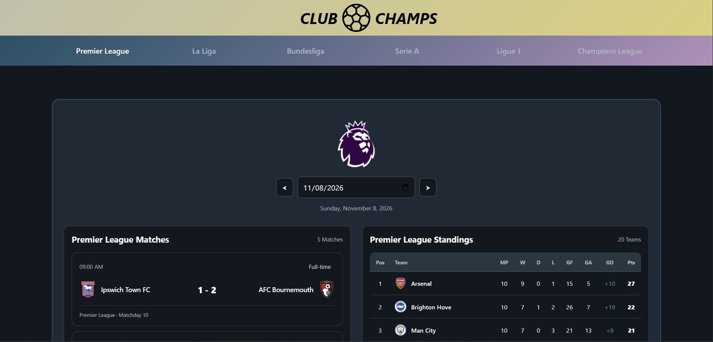

# Club Champs

View all the matches and standings for the current season of the top five football club leagues—Premier League, La Liga, Bundesliga, Serie A, and Ligue 1—as well as the UEFA Champions League.



## To run the project locally:

1. Clone this repository to your local machine:
```bash
git clone https://github.com/arekas659/clubchamps.git
```

2. Navigate to the project directory:
```bash
cd club-champs
```

3. Install the dependencies: 
```bash
npm install
```

4. Go to the URL below and signup to obtain an API key:
```bash
https://www.football-data.org
```

5 Delete "YOUR_API_KEY" and replace it with your actual API key in the .env file:
```bash
FOOTBALL_DATA_API_KEY=YOUR_API_KEY
```

6. Start the client and server:
```bash
npm run start:all
```

7. Open your browser and visit: 
```bash
http://localhost:5173
```
